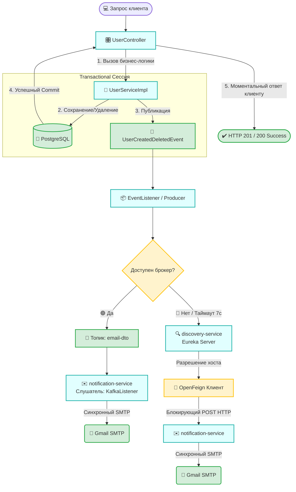

# 🚀 Микросервисная система: User & Notification Service

> Высоконагруженная событийно-ориентированная (EDA) система управления пользователями и мгновенных уведомлений с распределенной инфраструктурой, централизованным логированием и отказоустойчивыми механизмами доставки.

---

### 👥 Состав команды и роли
| Разработчик | Роль                                                     |
| :--- |:---------------------------------------------------------|
| **Максим Парфенов** | Backend / DevOps / QA Engineer                           |
| **Ирина Разинкова** | Backend / QA Engineer                                    |

### 📋 Управление задачами и доступ к таск-трекеру
Ведение бэклога, декомпозиция задач и контроль спринтов осуществляются в **Jira Cloud**.

*   **Ссылка на рабочее пространство:** [maxitool.atlassian.net](https://maxitool.atlassian.net)
*   **Как получить доступ:** Если вы хотите присоединиться к доске проекта, отправьте email-запрос на почту [Parfenov.max24@yandex.ru](mailto:Parfenov.max24@yandex.ru).

> **Шаблон темы письма:** `[Jira Access] Запрос доступа к spring проекту`  
> **В теле письма:** Укажите вашу рабочую/личную почту, на которую необходимо выслать официальное приглашение в Atlassian-инфраструктуру.

## 🛠️ Технологический стек проекта (Tech Stack)

Проект представляет собой распределенную микросервисную систему, построенную на базе передового enterprise-стека технологий экосистемы Java и развернутую в оптимизированном облачном контейнерном окружении.

### 📦 Спецификация платформы и DevOps-инфраструктуры

*   **Runtime Environment:** Java / JDK 26 (Официальные базовые runtime-образы `eclipse-temurin:26`).
*   **Build Automation:** Maven 3.9 (Многомодульная структура, централизованное управление зависимостями в корневом `pom.xml`).
*   **Контейнеризация и Контейнерная безопасность:**
    *   *Multi-stage Builds:* Сборка артефактов изолирована внутри промежуточного Docker-слоя на базе `maven:3.9-eclipse-temurin-26`, что исключает попадание исходного кода и избыточного кэша зависимостей в финальный образ.
    *   *Layer Caching:* Эффективное кэширование слоев Docker за счет предварительного кеширования зависимостей с помощью команды `mvn dependency:go-offline` перед копированием основного исходного кода.
    *   *Non-Root Execution:* Повышенная безопасность сред исполнения: процессы внутри контейнеров запускаются под системным не-привилегированным пользователем `spring:spring`.
*   **Оркестрация (Container Orchestration):** Docker Compose. Декларативное управление запуском 14 связанных контейнеров с контролем последовательности инициализации через расширенные условия `depends_on` (`service_healthy` / `service_started`).

### 🔀 Микросервисная архитектура (Spring Cloud & Core)

*   **Core Framework:** Spring Boot 4.1.x (Spring Web, Spring Data JPA, Spring Boot Actuator).
*   **Cloud Infrastructure:** Spring Cloud 2025.1.x:
    *   *Routing:* Spring Cloud Gateway (Единая точка входа, порт `8080`).
    *   *Service Discovery:* Netflix Eureka Server (Динамическая регистрация инстансов).
    *   *External Configuration:* Spring Cloud Config Server (Реактивное распределенное распределение .env конфигураций из удаленного Git-репозитория).
    *   *Load Balancing & Resilience:* Spring Cloud LoadBalancer, Resilience4j Circuit Breaker.
*   **Async Messaging:** Apache Kafka (Архитектура EDA, разделение топиков, обеспечение гарантий доставки через режим `enable.idempotence: true`).

### 💾 Уровень персистентности, Кэширования и Хранения данных

*   **СУБД общего пользования:** PostgreSQL 42.7.x (Cloud-инфраструктура, хостинг на NeonDB кластере AWS).
*   **Кэширование и Memory Grid:** Redis 7 (Использование легковесных контейнеров `redis:7-alpine`, персистентное сохранение данных через append-only файл на именованный volume `redis-data`).
*   **Тестовая СУБД:** H2 Database 2.4.x (In-Memory режим для изолированных тестовых прогонов).
*   **ORM Engine:** Hibernate (Автоматическая когерентность схем базы данных `ddl-auto: update`).

### 📝 Агрегация логов и Наблюдаемость (Observability)

*   **Логирование в коде:** slf4j API + аннотации `@Slf4j` компилятора Lombok.
*   **Форматирование и Транспорт:** Logstash Logback Encoder 9.0 (генерация структурированных логов для бесшовного парсинга).
*   **Сквозной сбор метрик логов:** Использование единого разделяемого Docker Volume (`shared-logs`), куда все микросервисы агрегируют файловый вывод.
*   **Сбор и Хранение:** Grafana Promtail (Агент-сборщик из общего volume `/var/log/shared-apps`) ➔ Grafana Loki 3.6 (Высокопроизводительное хранилище).
*   **Визуализация:** Grafana Dashboards (Порт `3000`, интерактивные панели мониторинга).

### 📖 API Спецификация и Документирование

*   **Спецификация:** OpenAPI 3.0 / Swagger.
*   **Интеграция:** Springdoc OpenAPI Starter 3.1.x (Включая раздельные стартеры `webmvc-ui` для микросервисов и реактивный `webflux-ui` для API Gateway).
*   **Hypermedia API (HATEOAS Engine):** Spring HATEOAS с полной поддержкой медиа-типов ответов `application/hal+json` и `application/prs.hal-forms+json` для автогенерации метаданных веб-форм.

### 🧪 Тестирование и Качество кода (QA)

*   **Модульное тестирование:** JUnit 5 (BOM-платформа `junit-bom` версии 6.1.x).
*   **Изоляция зависимостей:** Mockito 5.14.x (Аннотации `@Mock`, `@Spy`).
*   **Интеграционное тестирование:** Testcontainers 1.20.x (Динамическое развертывание баз данных и инфраструктуры Kafka в изолированном Docker-окружении во время фазы `test`).
*   **Веб-тестирование:** MockMvc (Тестирование контроллеров без аллокации сетевых портов).

---


## 🏗️ Архитектура системы и связи компонентов

### 🗺️ Диаграмма компонентов и связей
```mermaid
graph TD
    %% Компоненты системы
    Client([💻 Клиент / Браузер]) --> Gateway[🔀 Gateway Service<br/>Порт: 8080]

    subgraph Core ["Ядро системы"]
        Config[⚙️ Config Service<br/>Порт: 8888]
        Discovery["🔍 Discovery Server<br/>Eureka - Порт: 8761"]
        US[👥 User Service<br/>Порты: 8086, 8082]
        NS[✉️ Notification Service<br/>Порты: 8083, 8084]
    end

    subgraph Infrastructure ["Базы данных и Очереди"]
        Kafka[🖧 Apache Kafka<br/>Порт: 9092]
        Redis[💾 Redis<br/>Порт: 6379]
        DB[(🐘 PostgreSQL<br/>Neon Cloud)]
    end

    subgraph Observability ["Логирование и Мониторинг"]
        Volume[(📁 Shared Logs Volume)]
        Loki[🔥 Grafana Loki<br/>Порт: 3100] --> Grafana[📈 Grafana UI<br/>Порт: 3000]
    end

    %% ==========================================
    %% ПОТОКИ ДАННЫХ И СВЯЗИ (Важен порядок для linkStyle)
    %% ==========================================
    
    %% Основные бизнес-потоки (Трафик)
    Client --> Gateway                       %% Индекс 0
    Gateway -->|Роутинг API| US              %% Индекс 1
    Gateway -->|Роутинг API| NS              %% Индекс 2
    US --->|Кэш| Redis                       %% Индекс 3
    US --->|Данные| DB                        %% Индекс 4
    US --->|События| Kafka                   %% Индекс 5
    Kafka --->|События| NS                   %% Индекс 6

    %% Служебные связи: Раздача конфигураций (Config)
    Config -.->|Свойства| Discovery          %% Индекс 7
    Config -.->|Свойства| Gateway            %% Индекс 8
    Config -.->|Свойства| US                 %% Индекс 9
    Config -.->|Свойства| NS                 %% Индекс 10
    
    %% Служебные связи: Регистрация в Service Discovery (Eureka)
    Gateway --->|Регистрация| Discovery      %% Индекс 11
    US --->|Регистрация| Discovery           %% Индекс 12
    NS --->|Регистрация| Discovery           %% Индекс 13
    
    %% Служебные связи: Агрегация логов (Shared Volume)
    Gateway -->|Запись common.log| Volume    %% Индекс 14
    US -->|Запись common.log| Volume         %% Индекс 15
    NS -->|Запись common.log| Volume         %% Индекс 16
    Volume --> Loki                          %% Индекс 17
    Loki --> Grafana                         %% Индекс 18

    %% ==========================================
    %% ДЕКЛАРАЦИЯ СТИЛЕЙ UI
    %% ==========================================
    classDef clientStyle fill:#F3E8FF,stroke:#9333EA,stroke-width:2px;
    classDef gatewayStyle fill:#FFE4E6,stroke:#E11D48,stroke-width:2px,font-weight:bold;
    classDef coreStyle fill:#E0F2FE,stroke:#0284C7,stroke-width:2px;
    classDef infraStyle fill:#FEF3C7,stroke:#D97706,stroke-width:2px;
    classDef monitorStyle fill:#DCFCE7,stroke:#16A34A,stroke-width:2px;
    
    classDef subCore fill:#FAFAFA,stroke:#CBD5E1,stroke-width:1px,stroke-dasharray: 3 3;
    classDef subInfra fill:#FAFAFA,stroke:#CBD5E1,stroke-width:1px,stroke-dasharray: 3 3;
    classDef subMonitor fill:#FAFAFA,stroke:#CBD5E1,stroke-width:1px,stroke-dasharray: 3 3;

    %% Применение классов к узлам
    class Client clientStyle;
    class Gateway gatewayStyle;
    class Config,Discovery,US,NS coreStyle;
    class Kafka,Redis,DB infraStyle;
    class Volume,Loki,Grafana monitorStyle;
    
    %% Применение классов к подграфам
    class Core subCore;
    class Infrastructure subInfra;
    class Observability subMonitor;

    %% Стилизация стрелок (Ребер графа) строго по индексам
    %% Индексы 0-6: Основной бизнес-трафик, запросы и данные (Выделенный синий)
    linkStyle 0,1,2,3,4,5,6 stroke:#0284C7,stroke-width:2px;
    %% Индексы 7-10: Раздача конфигураций через Config Server (Пунктирный серый)
    linkStyle 7,8,9,10 stroke:#94A3B8,stroke-width:1px,stroke-dasharray: 4 4;
    %% Индексы 11-13: Регистрация инстансов в Service Discovery Eureka (Приглушенный индиго)
    linkStyle 11,12,13 stroke:#6366F1,stroke-width:1.5px;
    %% Индексы 14-18: Агрегация логов и вывод мониторинга (Мягкий зеленый)
    linkStyle 14,15,16,17,18 stroke:#16A34A,stroke-width:1.5px;
```

## 📨 Схема циркуляции событий (Event-Driven Flow)

Взаимодействие между `user-service` и `notification-service` спроектировано по событийно-ориентированной модели (EDA). Архитектура исключает жесткую связь: в случае недоступности брокера Kafka, система бесшовно деградирует до синхронных REST-вызовов через **OpenFeign** и **Eureka Server**, гарантируя доставку транзакционных уведомлений.

### 🔄 Потоки обработки событий и Резервные пути


### 📋 Спецификация контракта взаимодействия

#### 1. Структура Тела Сообщения (Payload DTO)
Обмен данными строго типизирован через `EmailDto` в виде Java Record:
```json
{
  "email": "test@mail.ru"
}
```
*Валидация на уровне контроллера:* Строка не должна быть пустой (`@NotBlank`), формат валидируется регулярным выражением (`@Email`), максимальная длина — 100 символов.

#### 2. Метаданные Заголовка (Kafka Headers)
Взаимодействие внутри распределенной сети является полиморфным и опирается на заголовки пакета (`RecordHeader`):
*   **Ключ заголовка:** `operation`
*   **Допустимые строковые значения (`byte[]`):** `create` или `delete`

На стороне потребителя `EmailDtoConsumer` вычитывает байты из заголовка `RECORD_HEADER_OPERATION_KEY`, преобразует их в строку UTF-8 и восстанавливает маппинг на `enum Operation` с помощью фабричного метода `Operation.fromString`. На основе полученного ключа из `Map<Operation, Consumer<EmailDto>> methods` вызывается соответствующий метод отправки почты.


<h3>Локальные url:</h3>
<p><a href="http://localhost:8761/">eureka</a></p>
<p><a href="http://localhost:8080/swagger-ui/index.html#">gateway-service</a></p>
<p><a href="http://localhost:8086/swagger-ui/index.html#">user-service-1</a></p>
<p><a href="http://localhost:8082/swagger-ui/index.html#">user-service-2</a></p>
<p><a href="http://localhost:8083/swagger-ui/index.html#">notification-service-1</a></p>
<p><a href="http://localhost:8084/swagger-ui/index.html#">notification-service-2</a></p>
<p><a href="http://localhost:8081/">redis-commander</a></p>
<p><a href="http://localhost:8070/">kafka-ui</a></p>
<p><a href="http://localhost:3000/">grafana</a>   лог:пар admin:admin</p>
<p><a href="http://localhost:8080/actuator/circuitbreakers">circuitbreakers</a></p>
<br>
<h3>О проекте:</h3>
<p>У нас в проекте 6 модулей user-service, notification-service, общий для них user-notification-common, discovery-service с Eureka сервером, gateway-service, config-service (для получения файлов конфигурации через гит (https://github.com/maxitool/test-spring-config-files.git)).</p>
<p>Для работы микросервисов параллельно мы настроили внутри проекта docker, чтобы запустить весь проект вам нужно в терминале ввести: docker-compose up --build. Глобальные переменные указаны в папке config.</p>
<p>В контейнере докера запускаются следующие микросервисы:</p>
<p>- discovery-service с Eureka сервером на порту 8761</p>
<p>- 2 копии notification-service (notification-service-1 и notification-service-2) на портах 8086 и 8082</p>
<p>- 2 копии user-service (user-service-1 и user-service-2) на портах 8083 и 8084</p>
<p>- gateway-service на порту 8080</p>
<p>- config-service на порту 8888</p>
<p>Также в докере запускается kafka на порту 9092 и kafka ui на порту 8070, redis на порту 6379 и redis-commander на порту 8081, Loki + Promtail + Grafana (централизованный сбор, хранение и визуализация логов). Логи пишутся в shared-logs волуме.</p>
<br>
<h3>Важно:</h3>
<p>До запуска в терминале команды docker-compose up --build необходимо включить впн, иначе отправка на почту работать не будет (Authentication failed).</p>
<br>
<h3>Удобный просмотр логов:</h3>
<p>После поднятия докер контейнера зайдите по ссылке http://localhost:3000, авторизируйтесь с логином (admin) и паролем (admin), после перейдите на вкладку Connections -> Data sources -> Add data source. В данной вкладке нужно выбрать loki, записать внутри Connection URL  http://loki:3100, после нажать на кнопку Save & test. Теперь перейдите на вкладку Explore, вам стало доступно написание Queries для получения логов.</p>
<br>
<p><b>Label filters:</b></p>
<p>filename - имя файла логов, доступно только /var/log/shared-apps/common.log (общий файл)</p>
<p>service - имя микросервиса</p>
<p>level - уровень логирования</p>
<br>
<p>Пример запроса для получении информации о том, какой хост и порт был дернут при вызове lb rest контроллера:</p>
<p>Label filters:</p>
<p>filename = /var/log/shared-apps/common.log</p>
<p>Operations:</p>
<p>Line Contains = Called</p>
<p>После нужно нажать на кнопку Live сверху</p>
<br>
<h3>База данных:</h3>
<p>Используем общую PostgreSQL, которая хостится на ресурсе neondb, ниже описаны настройки для подключения к ней</p>
<p>PGHOST = ep-lingering-cake-auei7dld-pooler.c-10.us-east-1.aws.neon.tech</p>
<p>PGUSER = neondb_owner</p>
<p>PGDATABASE = neondb</p>
<p>PGPASSWORD = npg_bQTMegkcO58F</p>
<br>
<h3>Договоренности:</h3>
<p>1) Не используем комментарии и javadoc
(Потому что код живет после того, как его написали. В процессе его жизни он будет не раз меняться и наступит переломный момент, когда код изменят, а javadoc - нет. В итоге этот javadoc никто так и не поменяет, он будет висеть бесполезным, потому что он противоречит реализации. Документацию в коде стоит писать только для библиотек/фреймворков/инструментов)</p>
<p>2) Пишем JUnit тесты для кода</p>
<p>3) Используем Jira для декомпозиции задач
(Ссылка на Jira: https://maxitool.atlassian.net). Доступ к сайту нужно запросить по почте Parfenov.max24@yandex.ru, указав в сообщение свою почту для добавления</p>
<p>4) Используем ci для проверки корректного выполнения тестов при пулл реквестах</p>
<p>5) Используем git ruleset для безопасности основных веток, ветки могут создавать админ репозитория и Jira</p>
<br>
<h2>Ход разработки</h2>
<h3>Задание 1:</h3>
<p>Было вне этого проекта.</p>
<br>
<h3>Задание 2:</h3>
<p>Разработать консольное приложение(user-service) на Java, использующее Hibernate для взаимодействия с PostgreSQL, без использования Spring. Приложение должно поддерживать базовые операции CRUD (Create, Read, Update, Delete) над сущностью User.</p>
<h4><i>Требования</i></h4>
<p>Использовать Hibernate в качестве ORM.</p>
<p>База данных — PostgreSQL.</p>
<p>Настроить Hibernate без Spring, используя hibernate.cfg.xml или properties-файл.</p>
<p>Реализовать CRUD-операции для сущности User (создание, чтение, обновление, удаление), которая состоит из полей: id, name, email, age, created_at.</p>
<p>Использовать консольный интерфейс для взаимодействия с пользователем.</p>
<p>Использовать Maven для управления зависимостями.</p>
<p>Настроить логирование.</p>
<p>Настроить транзакционность для операций с базой данных.</p>
<p>Использовать DAO-паттерн для отделения логики работы с БД.</p>
<p>Обработать возможные исключения, связанные с Hibernate и PostgreSQL</p>
<br>
<h4><i>Пояснения</i></h4>
<p>Версия проекта при сдачи 2 задания находится по тегу dz2.</p>
<p>Console readers нужны для чтения и валидации примитивов с консоли.</p>
<p>Gui - графический интерфейс через консоль, он создан с возможностью простого расширения функционала.</p>
<br>
<h3>Задание 3:</h3>
<p>Написать юнит-тесты и интеграционные тесты для user-service.</p>
<h4><i>Требования</i></h4>
<p>Использовать JUnit 5, Mockito и Testcontainers.</p>
<p>База данных — PostgreSQL.</p>
<p>Для тестирования Service-слоя написать юнит-тесты с использованием Mockito.</p>
<p>Тесты должны быть изолированы друг от друга.</p>
<br>
<h4><i>Пояснения</i></h4>
<p>Версия проекта при сдачи 3 задания находится по тегу dz3.</p>
<br>
<h3>Задание 4:</h3>
<p>Добавить в user-service поддержку Spring и разработать API, которое позволит управлять данными.</p>
<h4><i>Требования</i></h4>
<p>Использовать необходимые модули spring(boot, web, data etc).</p>
<p>Реализовать api для получения, создания, обновления и удаления юзера. Важно, entity не должен возвращаться из контроллера, необходимо использовать dto.</p>
<p>Заменить Hibernate на Spring data JPA.</p>
<p>Написать тесты для API(можно делать это при помощи mockMvc или других средств).</p>
<br>
<h3>Задание 5:</h3>
<p>Реализовать микросервис(notification-service) для отправки сообщения на почту при удалении или добавлении пользователя.и.</p>
<h4><i>Требования</i></h4>
<p>Использовать необходимые модули spring и kafka.</p>
<p>При удалении или создании юзера приложение, реализованное до этого(user-service), должно отправлять сообщение в kafka, в котором содержится информация об операции(удаление или создание) и email юзера.</p>
<p>Новый микросервис(notification-service) должен получить сообщение из kafka и отправить сообщение на почту юзера в зависимости от операции: удаление - Здравствуйте! Ваш аккаунт был удалён. Создание - Здравствуйте! Ваш аккаунт на сайте ваш сайт был успешно создан.</p>
<p>Также отдельно добавить API, которая будет отправлять сообщение на почту(почти тот же функционал, что и через кафку).</p>
<p>Написать интеграционные тесты для проверки отправки сообщения на почту.</p>
<br>
<h3>Задание 6:</h3>
<p>Добавление Swagger-документации и HATEOAS в API.</p>
<h4><i>Требования</i></h4>
<p>Задокументировать существующее API (из задания 4) с помощью Swagger (Springdoc OpenAPI), чтобы можно было легко изучить и тестировать API через веб-интерфейс.</p>
<p>Добавить поддержку HATEOAS, чтобы API предоставляло ссылки для навигации по ресурсам.</p>
<br>
<h3>Задание 7:</h3>
<p>Добавить к существующей системе паттерны: gateway api, service discovery, circuit breaker, external configuration - реализации данных паттернов можно найти в модулях spring cloud.</p>
<br>
<h3>Задание 8:</h3>
<p>DevOps</p>
<p>Создать docker-compose.yml, который развернет всю микросервисную систему, включая Kafka, PostgreSQL, API Gateway, Service Discovery, External Configuration и 2 микросервиса(user-service и notification-service, созданные ранее). Проверить, что сервисы корректно взаимодействуют друг с другом в контейнерной среде.</p>