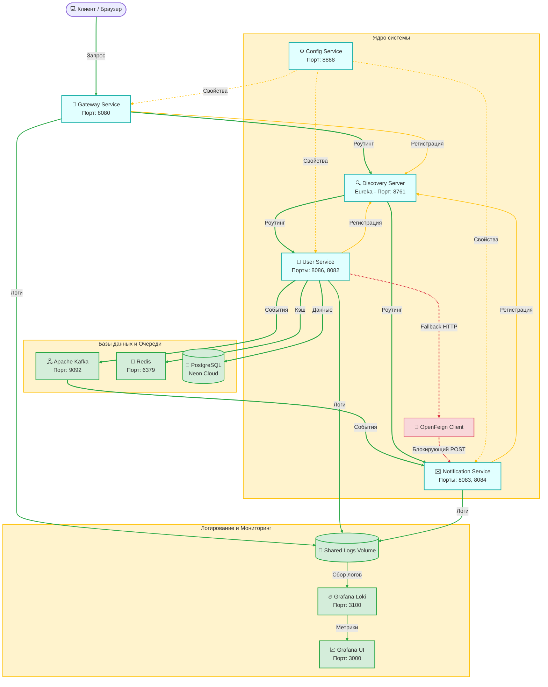

# 🚀 Микросервисная система: User & Notification Service

> Событийно-ориентированная (EDA) система управления пользователями и мгновенных уведомлений с распределенной инфраструктурой, централизованным логированием и отказоустойчивыми механизмами доставки.

---

## 🔥 Команда проекта / Team

### 👥 Состав команды и роли
| Разработчик | Роль                                                     |
| :--- |:---------------------------------------------------------|
| **Максим Парфенов** | Backend / DevOps / QA Engineer                           |
| **Ирина Разинкова** | Backend / QA Engineer                                    |

<br>

### 📋 Управление задачами и доступ к таск-трекеру
Ведение бэклога, декомпозиция задач и контроль спринтов осуществляются в **Jira Cloud**.

*   **Ссылка на рабочее пространство:** [maxitool.atlassian.net](https://maxitool.atlassian.net)
*   **Как получить доступ:** Если вы хотите присоединиться к доске проекта, отправьте email-запрос на почту [Parfenov.max24@yandex.ru](mailto:Parfenov.max24@yandex.ru).

> **Шаблон темы письма:** `[Jira Access] Запрос доступа к spring проекту`  
> **В теле письма:** Укажите вашу рабочую/личную почту, на которую необходимо выслать официальное приглашение в Atlassian-инфраструктуру.

<br>

### 🤝 Командные соглашения (Team Agreements)

<details>
<summary><b>1. Принцип самодокументируемого кода (No Javadoc/Comments)</b></summary>

*   **Подробнее:** Мы принципиально не пишем комментарии и Javadoc внутри бизнес-логики. Бизнес-требования часто меняются, код рефакторится, а комментарии устаревают и начинают вводить команду в заблуждение. Документация пишется только для модулей уровня общего фреймворка или внешних библиотек.
</details>

<details>
<summary><b>2. Покрытие тестами</b></summary>

*   **Подробнее:** Написание JUnit-тестов является неотъемлемой частью любой подзадачи. Успешное выполнение тест-паков проверяется перед каждым пулл реквестом с помощью ci.
</details>

<details>
<summary><b>3. Декомпозиция задач</b></summary>

*   **Подробнее:** Любая активность строго фиксируется, оценивается и декомпозируется в Jira.
</details>

<details>
<summary><b>4. Проверка CI</b></summary>

*   **Подробнее:** Контроль успешного прохождения тест-паков автоматизирован через механизмы Continuous Integration на каждом Pull Request.
</details>

<details>
<summary><b>5. Безопасность ветвления</b></summary>

*   **Подробнее:** Защита ключевых веток (`main`, `develop`, `spring-develop`, `spring-kafka-develop`) обеспечена через Git Ruleset. Прямые пуши запрещены.
</details>

<br>

---

## 🚀 Инструкция по быстрому запуску стека

### ⚠️ ВАЖНОЕ ТРЕБОВАНИЕ ПЕРЕД ЗАПУСКОМ
> Перед выполнением сборки **обязательно включите VPN** на хост-машине. Без активного VPN-подключения внешние SMTP-серверы Google заблокируют отправку писем с контейнеров, и система выбросит исключение `Authentication failed`.

<br>

### Команда развертывания
Запустите сборку и старт всей инфраструктуры одной командой из корневой директории:
```bash
docker-compose up --build
```
<br>

---


## 📍 Навигация по локальным URL (Dashboard)

| Компонент | Локальный URL | Описание панели / Инструмента                          |
| :--- | :--- |:-------------------------------------------------------|
| **API Gateway** | [http://localhost:8080/swagger-ui/index.html](http://localhost:8080/swagger-ui/index.html) | Единая точка входа                           |
| **Service Discovery** | [http://localhost:8761/](http://localhost:8761/) | Панель мониторинга зарегистрированных инстансов Eureka |
| **Grafana** | [http://localhost:3000/](http://localhost:3000/) | Панель мониторинга логов (`admin` / `admin`)           |
| **Kafka UI** | [http://localhost:8070/](http://localhost:8070/) | Просмотр топиков, партиций и сообщений брокера         |
| **Redis Commander** | [http://localhost:8081/](http://localhost:8081/) | Веб-интерфейс для просмотра кэша структуры Redis       |
| **Circuit Breakers** | [http://localhost:8080/actuator/circuitbreakers](http://localhost:8080/actuator/circuitbreakers) | Состояние предохранителей Resilience4j на шлюзе        |
| **User Service 1** | [http://localhost:8086/swagger-ui/index.html](http://localhost:8086/swagger-ui/index.html) | Прямой Swagger первого инстанса пользователей          |
| **User Service 2** | [http://localhost:8082/swagger-ui/index.html](http://localhost:8082/swagger-ui/index.html) | Прямой Swagger второго инстанса пользователей          |
| **Notification 1** | [http://localhost:8083/swagger-ui/index.html](http://localhost:8083/swagger-ui/index.html) | Прямой Swagger первого инстанса уведомлений            |
| **Notification 2** | [http://localhost:8084/swagger-ui/index.html](http://localhost:8084/swagger-ui/index.html) | Прямой Swagger второго инстанса уведомлений            |

<br>

---

## 🔎 Работа с логами в Grafana Loki

Логи всех сервисов пишутся в именованный Docker Volume `shared-logs` и агрегируются сборщиком **Promtail**.

### Первичная настройка панелей логов:
1. Перейдите в [Grafana](http://localhost:3000) (Данные для входа: `admin` / `admin`).
2. Откройте меню **Connections** -> **Data sources** -> **Add data source**.
3. Выберите тип хранилища **Loki**.
4. В поле *Connection URL* укажите внутренний сетевой адрес контейнера: `http://loki:3100`.
5. Нажмите кнопку **Save & test**.
6. Перейдите во вкладку **Explore** для выполнения поисковых запросов.

<br>

### Индексируемые лейблы (Label filters):
*   `filename` — Путь к файлу логов. Доступен общий агрегированный лог: `/var/log/shared-apps/common.log`.
*   `service` — Уникальное имя микросервиса.
*   `level` — Уровень логирования (`INFO`, `DEBUG`, `WARN`, `ERROR`).

💡 **Полезный паттерн поискового запроса (Проверка балансировщика):**
Чтобы посмотреть, какой именно инстанс был выбран балансировщиком нагрузки при обработке Rest-контроллера, выберите лейбл `filename = /var/log/shared-apps/common.log`, в поле операций выберите `Line Contains = Called` и переключите тумблер в режим **Live** сверху экрана.

<br>

---

## 🛠️ Технологический стек проекта (Tech Stack)

Проект представляет собой распределенную микросервисную систему, построенную на базе передового enterprise-стека технологий экосистемы Java и развернутую в оптимизированном облачном контейнерном окружении.

### 📦 Спецификация платформы и DevOps-инфраструктуры

*   **Runtime Environment:** Java / JDK 26 (Официальные базовые runtime-образы `eclipse-temurin:26`).
*   **Build Automation:** Maven 3.9 (Многомодульная структура, централизованное управление зависимостями в корневом `pom.xml`).
*   **Контейнеризация и Контейнерная безопасность:**
    *   *Multi-stage Builds:* Сборка артефактов изолирована внутри промежуточного Docker-слоя на базе `maven:3.9-eclipse-temurin-26`, что исключает попадание исходного кода и избыточного кэша зависимостей в финальный образ.
    *   *Layer Caching:* Эффективное кэширование слоев Docker за счет предварительного кеширования зависимостей с помощью команды `mvn dependency:go-offline` перед копированием основного исходного кода.
    *   *Non-Root Execution:* Повышенная безопасность сред исполнения: процессы внутри контейнеров запускаются под системным не-привилегированным пользователем `spring:spring`.
*   **Оркестрация (Container Orchestration):** Docker Compose. Декларативное управление запуском 14 связанных контейнеров с контролем последовательности инициализации через расширенные условия `depends_on` (`service_healthy` / `service_started`).

### 🔀 Микросервисная архитектура (Spring Cloud & Core)

*   **Core Framework:** Spring Boot 4.1.x (Spring Web, Spring Data JPA, Spring Boot Actuator).
*   **Cloud Infrastructure:** Spring Cloud 2025.1.x:
    *   *Routing:* Spring Cloud Gateway (Единая точка входа, порт `8080`).
    *   *Service Discovery:* Netflix Eureka Server (Динамическая регистрация микросервисов).
    *   *External Configuration:* Spring Cloud Config Server (Реактивное распределенное распределение .env конфигураций из удаленного Git-репозитория).
    *   *Load Balancing & Resilience:* Spring Cloud LoadBalancer, Resilience4j Circuit Breaker.
*   **Async Messaging:** Apache Kafka (Архитектура EDA, разделение топиков, обеспечение гарантий доставки через режим `enable.idempotence: true`).

### 💾 Кэширования и Хранения данных

*   **СУБД общего пользования:** PostgreSQL 42.7.x (Cloud-инфраструктура, хостинг на NeonDB).
*   **Кэширование и Memory Grid:** Redis 7 (Использование легковесных контейнеров `redis:7-alpine`, персистентное сохранение данных через append-only файл на именованный volume `redis-data`).
*   **Тестовая СУБД:** H2 Database 2.4.x (In-Memory режим для изолированных тестовых прогонов).

### 📝 Агрегация логов и Наблюдаемость (Observability)

*   **Логирование в коде:** Аннотации `@Slf4j` компилятора Lombok.
*   **Форматирование и Транспорт:** Logstash Logback Encoder 9.0 (генерация структурированных логов для бесшовного парсинга).
*   **Сквозной сбор метрик логов:** Использование единого разделяемого Docker Volume (`shared-logs`), куда все микросервисы агрегируют файловый вывод.
*   **Сбор и Хранение:** Grafana Promtail (Агент-сборщик из общего volume `/var/log/shared-apps`) ➔ Grafana Loki 3.6 (Высокопроизводительное хранилище).
*   **Визуализация:** Grafana Dashboards (Порт `3000`, интерактивные панели мониторинга).

### 📖 API Спецификация и Документирование

*   **Спецификация:** OpenAPI 3.0 / Swagger.
*   **Интеграция:** Springdoc OpenAPI Starter 3.1.x (Включая раздельные стартеры `webmvc-ui` для микросервисов и реактивный `webflux-ui` для API Gateway).
*   **Hypermedia API (HATEOAS Engine):** Spring HATEOAS с полной поддержкой медиа-типов ответов `application/hal+json` и `application/prs.hal-forms+json` для автогенерации метаданных веб-форм.

### 🧪 Тестирование и Качество кода (QA)

*   **Модульное тестирование:** JUnit 5 (BOM-платформа `junit-bom` версии 6.1.x).
*   **Изоляция зависимостей:** Mockito 5.14.x (Аннотации `@Mock`, `@Spy`).
*   **Интеграционное тестирование:** Testcontainers 1.20.x (Динамическое развертывание баз данных и инфраструктуры Kafka в изолированном Docker-окружении во время фазы `test`).
*   **Веб-тестирование:** MockMvc (Тестирование контроллеров без аллокации сетевых портов).

<br>

---

## 🏗️ Архитектура системы и связи компонентов

### 🗂️ Многомодульная структура репозитория

В соответствии с конфигурацией сборщика, проект декомпозирован на следующие изолированные модули:
1.  `user-service` — Управление бизнес-логикой пользователей, транзакциями PostgreSQL и кэшированием Redis, Producer сообщений Kafka.
2. `notification-service` — Почтовый SMTP-клиент и Consumer сообщений Kafka.
3. `user-notification-common` — Общие разделяемые DTO (`EmailDto`), Operation enums и константы между `user-service` и `notification-service`.
4. `config-service` — Сервер распределенной внешней конфигурации (Spring Cloud Config). [Git репозиторий](https://github.com/maxitool/test-spring-config-files).
5. `discovery-service` — Сервер регистрации и динамического обнаружения микросервисов Eureka.
6. `gateway-service` — Единая точка входа, маршрутизатор и Circuit Breaker всего стека.

<br>

### ⚙️ Глобальная облачная база данных (PostgreSQL)

В качестве основного хранилища используется managed-решение **NeonDB**. Параметры подключения:

```ini
PGHOST     = ep-lingering-cake-auei7dld-pooler.c-10.us-east-1.aws.neon.tech
PGUSER     = neondb_owner
PGDATABASE = neondb
PGPASSWORD = npg_bQTMegkcO58F
```

<br>

### 🗺️ Диаграмма компонентов и связей



---

## 📨 Схема циркуляции событий (Event-Driven Flow)

Взаимодействие между `user-service` и `notification-service` спроектировано по событийно-ориентированной модели (EDA). Архитектура исключает жесткую связь: в случае недоступности брокера Kafka, система бесшовно деградирует до синхронных REST-вызовов через **OpenFeign** и **Eureka Server**, гарантируя доставку транзакционных уведомлений.

### 🔄 Потоки обработки событий и Резервные пути


<br>

### 📋 Спецификация контракта взаимодействия

#### 1. Структура Тела Сообщения (Payload DTO)
Обмен данными строго типизирован через `EmailDto` в виде Java Record:
```json
{
  "email": "test@mail.ru"
}
```
*Валидация на уровне контроллера:* Строка не должна быть пустой (`@NotBlank`), формат валидируется регулярным выражением (`@Email`), максимальная длина — 100 символов.

#### 2. Метаданные Заголовка (Kafka Headers)
Взаимодействие внутри распределенной сети является полиморфным и опирается на заголовки пакета (`RecordHeader`):
*   **Ключ заголовка:** `operation`
*   **Допустимые строковые значения (`byte[]`):** `create` или `delete`

На стороне потребителя `EmailDtoConsumer` вычитывает байты из заголовка `RECORD_HEADER_OPERATION_KEY`, преобразует их в строку UTF-8 и восстанавливает маппинг на `enum Operation` с помощью фабричного метода `Operation.fromString`. На основе полученного ключа из `Map<Operation, Consumer<EmailDto>> methods` вызывается соответствующий метод отправки почты.

<br>

---

## 📈 Хронология и этапы эволюции проекта

<details>
<summary><b>Этап 1: Написать собственную реализацию HashMap</b></summary>

*   **Задача:** Необходимо написать собственную реализацию `HashMap`. Обязательные методы: get, put, remove.
*   **Реализовано:** Вне этого проекта. [Git ссылка](https://github.com/maxitool/simple-sample-of-hashmap)
</details>

<details>
<summary><b>Этап 2: Чистый Hibernate Core (без Spring Framework)</b></summary>

*   **Задача:** Разработать консольное приложение(`user-service`) на Java, использующее `Hibernate` для взаимодействия с `PostgreSQL`, без использования `Spring`. Приложение должно поддерживать базовые операции CRUD (Create, Read, Update, Delete) над сущностью `User`.
*   **Требования:** <p>Использовать `Hibernate` в качестве ORM.</p><p>База данных — `PostgreSQL`.</p><p>Настроить Hibernate без `Spring`, используя hibernate.cfg.xml или properties-файл.</p><p>Реализовать CRUD-операции для сущности User (создание, чтение, обновление, удаление), которая состоит из полей: id, name, email, age, created_at.</p><p>Использовать консольный интерфейс для взаимодействия с пользователем.</p><p>Использовать Maven для управления зависимостями.</p><p>Настроить логирование.</p><p>Настроить транзакционность для операций с базой данных.</p><p>Использовать DAO-паттерн для отделения логики работы с БД.</p><p>Обработать возможные исключения, связанные с `Hibernate` и `PostgreSQL`</p>
*   **Реализовано:** Создана модель данных `User`, изолирована логика работы с БД через паттерн **DAO**, настроен интерактивный GUI-интерфейс. Данный этап был сохранен в отдельном [Git репозитории](https://github.com/maxitool/hibernate-user-service/tree/develop).
</details>

<details>
<summary><b>Этап 3: Изолированное тестирование и Testcontainers</b></summary>

*   **Задача:** Написать юнит-тесты и интеграционные тесты для `user-service`.
*   **Требования:**<p>Использовать JUnit 5, Mockito и Testcontainers.</p><p>База данных — PostgreSQL.</p><p>Для тестирования Service-слоя написать юнит-тесты с использованием Mockito.</p><p>Тесты должны быть изолированы друг от друга.</p>
*   **Реализовано:** Написаны изолированные модульные юнит-тесты с применением `JUnit 5` и `Mockito`. Интегрированы контейнерные тесты базы данных на базе `Testcontainers`. Данный этап был сохранен в отдельном [Git репозитории](https://github.com/maxitool/hibernate-user-service/tree/develop).
</details>

<details>
<summary><b>Этап 4: Миграция системы на экосистему Spring Boot</b></summary>

*   **Задача:** Добавить в `user-service` поддержку `Spring` и разработать API, которое позволит управлять данными.
*   **Требования:**<p>Использовать необходимые модули spring(boot, web, data etc).</p><p>Реализовать api для получения, создания, обновления и удаления юзера. Важно, entity не должен возвращаться из контроллера, необходимо использовать dto.</p><p>Заменить `Hibernate` на `Spring data JPA`.</p><p>Написать тесты для API(можно делать это при помощи `mockMvc` или других средств).</p>
*   **Реализовано:** Конфигурация Hibernate заменена решением **Spring Data JPA**. Написаны REST-контроллеры, внедрен маппинг сущностей в структуры **DTO**, реализовано веб-тестирование через `MockMvc`.
</details>

<details>
<summary><b>Этап 5: Асинхронное взаимодействие и интеграция Apache Kafka</b></summary>

*   **Задача:** Реализовать микросервис(`notification-service`) для отправки сообщения на почту при удалении или добавлении пользователя.
*   **Требования:**<p>Использовать необходимые модули `spring` и `kafka`.</p><p>При удалении или создании юзера приложение, реализованное до этого(`user-service`), должно отправлять сообщение в kafka, в котором содержится информация об операции(удаление или создание) и email юзера.</p><p>Новый микросервис(`notification-service`) должен получить сообщение из kafka и отправить сообщение на почту юзера в зависимости от операции: удаление - Здравствуйте! Ваш аккаунт был удалён. Создание - Здравствуйте! Ваш аккаунт на сайте ваш сайт был успешно создан.</p><p>Также отдельно добавить API, которая будет отправлять сообщение на почту(почти тот же функционал, что и через кафку).</p><p>Написать интеграционные тесты для проверки отправки сообщения на почту.</p>
*   **Реализовано:** Внедрен брокер сообщений Apache Kafka. `user-service` отправляет события в топик, а `notification-service` вычитывает их и генерирует почтовые уведомления (с поддержкой Fallback-механизма через `OpenFeign`).
</details>

<details>
<summary><b>Этап 6: Документирование и реализация концепции HATEOAS</b></summary>

*   **Задача:** Добавление `Swagger`-документации и `HATEOAS` в API.
*   **Требования:**<p>Задокументировать существующее API (из задания 4) с помощью `Swagger` (`Springdoc OpenAPI`), чтобы можно было легко изучить и тестировать API через веб-интерфейс.</p><p>Добавить поддержку `HATEOAS`, чтобы API предоставляло ссылки для навигации по ресурсам.</p>
*   **Реализовано:** Подключена библиотека `Springdoc OpenAPI` (Swagger UI). В эндпоинты добавлен модуль `Spring HATEOAS` с поддержкой спецификаций `HAL` и `HAL-Forms` для передачи медиа-ссылок навигации.
</details>

<details>
<summary><b>Этап 7: Облачная инфраструктура Spring Cloud</b></summary>

*   **Задача:** Добавить к существующей системе паттерны: `gateway api`, `service discovery`, `circuit breaker`, `external configuration` - реализации данных паттернов можно найти в модулях spring cloud.
*   **Реализовано:** Интегрирован **Service Discovery (Eureka Server)**, поднят шлюз **Spring Cloud Gateway**, внедрен **Config Server** и настроен предохранитель **Circuit Breaker** (Resilience4j) на шлюзе.
</details>

<details>
<summary><b>Этап 8: Оркестрация и DevOps автоматизация</b></summary>

*   **Задача:** Создать docker-compose.yml, который развернет всю микросервисную систему, включая `Kafka`, `PostgreSQL`, `API Gateway`, `Service Discovery`, `External Configuration` и 2 микросервиса(`user-service` и `notification-service`, созданные ранее). Проверить, что сервисы корректно взаимодействуют друг с другом в контейнерной среде.
*   **Реализовано:** Для каждого кастомного сервиса спроектированы легковесные файлы сборки `Dockerfile`. Скомпонован единый мастер-манифест `docker-compose.yml`, оркеструющий развертывание 14 контейнеров.
</details>

<br>